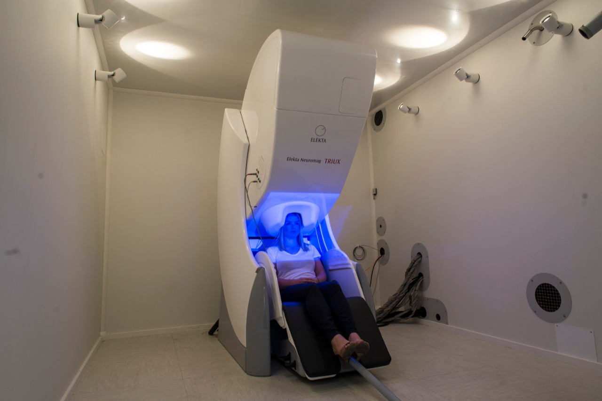

# Magnetoencephalography (MEG)
{:.sni-img} 
Image: The SQUID MEG system at Swinburne.

Magnetoencephalography (MEG) is an imaging technique that maps brain activity by detecting the extremely small magnetic fields produced by electric currents in the brain.

MEG is particularly well suited to research into:

- epilepsy and seizure localisation
- traumatic brain injury
- dementia and neurodegenerative conditions
- stroke and recovery
- anxiety and depression
- autism and ADHD

## The MEG system
Swinburne Neuroimaging houses an **Elekta/MEGIN Neuroma TRIUX 306-channel MEG system** in a purpose-built, highly magnetically shielded room.

See the [Elekta/MEGIN Neuroma TRIUX datasheet and technical specifications](https://natmeg.se/onewebmedia/NM23083B-A%20Elekta%20Neuromag%20TRIUX%20datasheet.pdf){target="_blank"}.

## Motion Capture & Video Recording
The MEG lab integrates a **Qualisys motion capture system** with the MEG environment, providing a high-precision, time-synchronized motion tracking and video recording. By tightly aligning physical movement data with neuroimaging data, this setup allows for detailed studies of:

- Motor control: the neural correlates of movement planning, execution, and correction at millisecond resolution
- Sensorimotor integration: how the brain combines sensory feedback with motor commands in real time
- Naturalistic behaviour: paradigms that would be impossible in a conventional, motion-restricted scanner environment

## Eye Tracking
The MEG lab is equipped with an **SR Research EyeLink 1000 Plus**, a high-speed, MEG-compatible eye tracker for precise, time-synchronized gaze and pupillometric measurements during functional scanning. 

!!! note "Eye tracking in MRI"
    Eye tracking data is also available in MRI sessions. See MRI Overview & Specs for details.

## Nerve Stimulation
The MEG laboratory supports the integration of advanced nerve stimulation protocols directly inside the scanning environment. This setup allows researchers to deliver targeted nerve stimulation during active scans. 
